# Architecture (as built)

This is a map of how open-dictionary works today, drawn from the code at commit
`7a1fe53` (2026-11-25). The `design-*.md` files next to it explain *why* each
subsystem was designed the way it was, at the time it was designed; some of
their file names and details have since moved. When this document and a design
doc disagree, trust this one, and trust the code over both.

If you want a guided reading order rather than a reference, start with the
[learning guide](./learning-guide.md).

**Contents**

1. [The system in one picture](#1-the-system-in-one-picture)
2. [Tech stack](#2-tech-stack)
3. [Codebase at a glance](#3-codebase-at-a-glance)
4. [Repository map](#4-repository-map)
5. [Production topology](#5-production-topology)
6. [API server](#6-api-server)
7. [The lookup pipeline](#7-the-lookup-pipeline)
8. [LLM provider layer](#8-llm-provider-layer)
9. [Cost control](#9-cost-control)
10. [Data model](#10-data-model)
11. [Identity and auth](#11-identity-and-auth)
12. [Web app](#12-web-app)
13. [Browser extension](#13-browser-extension)
14. [Admin plane](#14-admin-plane)
15. [Build, prerender and deploy](#15-build-prerender-and-deploy)
16. [Failure behaviour](#16-failure-behaviour)

---

## 1. The system in one picture

A user looks up a word. The answer is written by an LLM the first time anyone
asks for it, stored in MongoDB, and served from there to everyone afterwards.
Everything else in the system exists to make that first generation fast
(streaming, parallel calls, fusion), affordable (rate limits, quotas, budgets),
and operable (admin portal, activity log, audit).

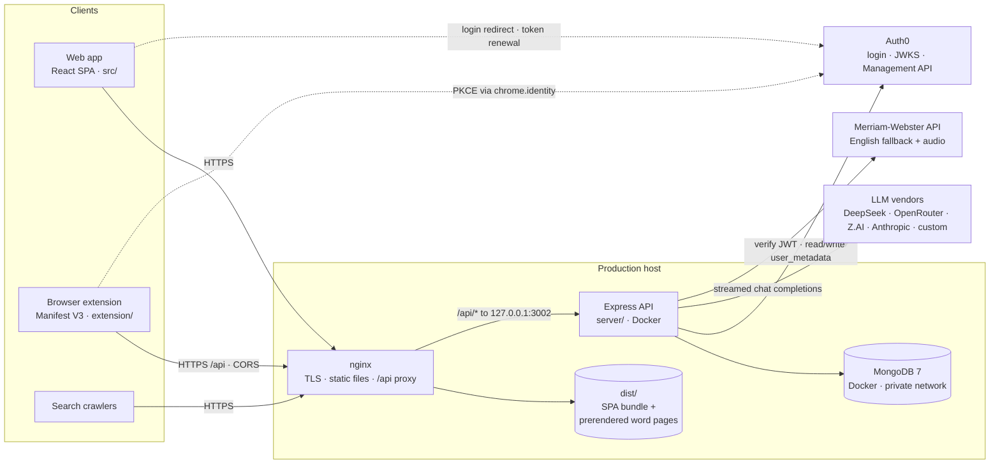

Four things worth holding on to:

- **One API, two clients.** The web app and the extension call the same
  endpoints and share code through `shared/`.
- **MongoDB is a cache first.** The `translations` collection is the product's
  content. Losing it costs money (regeneration), not correctness.
- **The LLM is replaceable at runtime.** Vendors sit behind one interface
  (`LlmProvider`), and the active one can be changed from the admin portal
  without a restart.
- **Crawlers never reach the LLM.** They get prerendered static HTML for words
  already in the cache, and are refused on LLM-backed API routes.

## 2. Tech stack

| Layer | Choice | Where |
|---|---|---|
| Language | TypeScript, strict mode, everywhere | `tsconfig.json` |
| Web UI | React 18, React Router 6, plain CSS | `src/` |
| Web build | Vite 8 (dev server proxies `/api` to `:3001`) | `vite.config.ts` |
| API | Express 4, run directly from TypeScript with `tsx` (no compile step) | `server/` |
| Database | MongoDB 7, official `mongodb` driver, no ODM | `server/db.ts` |
| Auth | Auth0: `@auth0/auth0-react` in the SPA, `express-oauth2-jwt-bearer` on the API, `auth0` Management SDK for user metadata | `src/main.tsx`, `server/app.ts` |
| LLM access | Plain `fetch` against three wire protocols: OpenAI Chat Completions, OpenAI Responses, Anthropic Messages. No vendor SDKs | `server/providers/llm/` |
| Dictionary fallback | Merriam-Webster Collegiate API | `server/providers/dictionary.ts` |
| HTTP hardening | `helmet`, `cors` allowlist, `express-rate-limit` | `server/app.ts` |
| Extension | Manifest V3, React, `@crxjs/vite-plugin` | `extension/` |
| Tests | Vitest (unit tests next to the code, `*.test.ts`) | everywhere |
| Deploy | Docker Compose (API + Mongo), host nginx for TLS and static files | `docker-compose.yml`, `scripts/deploy-prod.sh` |
| CI | GitHub Actions: typecheck, unit tests, build, smoke-start, `npm audit`; a second job typechecks and builds the extension | `.github/workflows/ci.yml` |

## 3. Codebase at a glance

TypeScript only, counted from tracked files at commit `7a1fe53`.

| Area | Source files | Source lines | Test files | Test lines |
|---|---:|---:|---:|---:|
| `server/` (API) | 58 | 12,781 | 44 | 6,628 |
| `src/` (web app) | 74 | 8,893 | 3 | 332 |
| `extension/src/` | 26 | 2,666 | 11 | 1,133 |
| `scripts/` | 6 | 719 | 2 | 294 |
| `shared/` | 9 | 270 | 6 | 215 |
| **Total** | **173** | **25,329** | **66** | **8,602** |

- `npm test` runs 687 tests in 66 files in about 2 seconds. None of them need
  MongoDB, Auth0 or a network connection; `vite.config.ts` supplies placeholder
  values for the four required `AUTH0_*` variables.
- Test weight is on the server, where the money and the concurrency are. The
  web app is thinly tested.
- The largest source files are `server/admin/router.ts` (1,191 lines),
  `src/api/admin.ts` (903), `server/translate.ts` (872) and
  `src/i18n/translations.ts` (729).
- The Markdown docs add up to roughly 8,500 lines, most of it design rationale.

## 4. Repository map

One repository, four runtimes. `shared/` is the only code that runs in more
than one of them, which is why it has no dependencies on Node, the DOM, or
React.

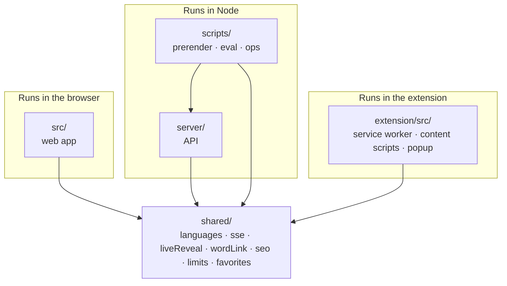

| Directory | What lives there |
|---|---|
| `server/` | The API. One file per feature at the top level (`translate.ts`, `favorites.ts`, `suggest.ts`, …), with subdirectories for the bigger subsystems: `providers/` (LLM + dictionary), `llm/` (hot-swappable provider service), `usage/` (quotas), `admin/` (portal backend), `cache/`. |
| `src/` | The web app: `api/` (fetch clients), `hooks/` (state), `components/`, `pages/`, `i18n/`, `styles/`. Admin UI is under `pages/admin/` and `components/admin/`, loaded lazily. |
| `extension/` | A separate npm package with its own `package.json`. `background/` is the service worker, `content/` runs inside web pages, `popup/` and `options/` are extension pages. |
| `shared/` | Small pure modules imported by all of the above. |
| `scripts/` | Run by hand or by the deploy script: SEO prerender, LLM eval harness, backups, a one-time backfill. |
| `docs/` | Design docs, operations notes, this file. |

The root `tsconfig.json` covers `src`, `server` and `shared`. The extension has
its own config, so `npm run typecheck` and `npm run build` at the root do **not**
check it (root `npm test` does run its tests).

## 5. Production topology

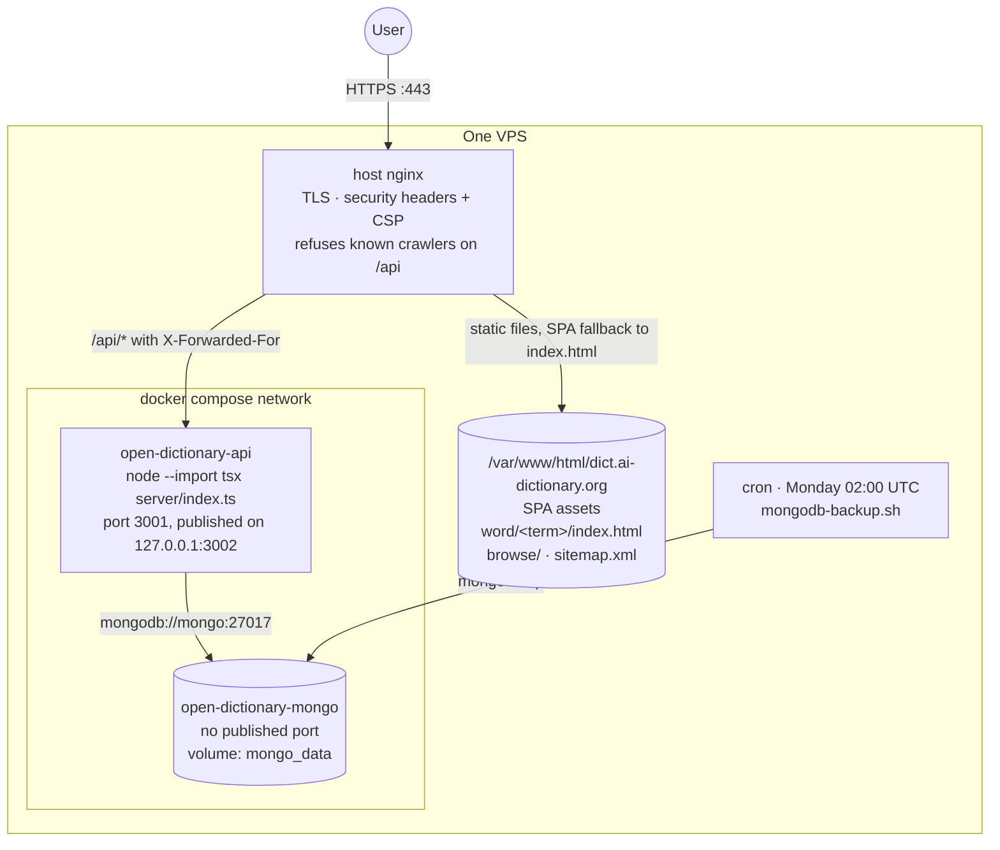

Details that matter in practice:

- The API container listens on `3001` and is published only on the host's
  loopback as `3002`. Nothing outside the host can reach it except through
  nginx.
- MongoDB publishes no port at all. Tools that need it (the prerender script)
  run in a throwaway container on the compose network.
- `TRUST_PROXY=1` makes Express read the client IP from `X-Forwarded-For`.
  Rate limits, budgets and the blocklist all key on that IP, so every nginx
  vhost that proxies `/api/` must send the header.
- There is a single API container. Several pieces of state are deliberately
  in-process (see [§6.4](#64-state-that-lives-in-the-process)), which is fine
  for one container and would need rework for several.

## 6. API server

### 6.1 Boot sequence

`server/index.ts` is a top-to-bottom script:

1. `config.ts` loads `.env` and `server/.env`, and exits if a required Auth0
   variable is missing.
2. Build the Merriam-Webster provider.
3. Build the **env baseline** LLM provider from `LLM_VENDOR` and the matching
   key (`createLlmProviderFromEnv`), and wrap it in an `LlmService`.
4. If `MONGODB_URI` is set: connect, create indexes (idempotent), create the
   translation cache, then call `llmService.reloadFromDb()` so an
   admin-configured provider replaces the env baseline. Load usage settings
   and model prices.
5. `createApp(...)` builds the Express app, and `listen` starts it.
6. Start two timers: a metrics log line every 5 minutes, and a daily job that
   strips creator IPs from cache entries older than 180 days.
7. Install `SIGTERM`/`SIGINT` handlers for a graceful shutdown.

A failed Mongo connection is logged and the server still starts, with the
cache and favorites disabled. Nothing here throws on a missing LLM key either:
the LLM tier is reported as `misconfigured` and lookups fall back to the
dictionary.

### 6.2 Middleware and routes

Every request passes `helmet` → CORS allowlist → JSON body parser (64 KB) →
`blocklistGuard` (on `/api`, admin routes exempt), then reaches a router.

| Route | Auth | Per-minute limit | Reaches the LLM? | Module |
|---|---|---|---|---|
| `GET /health` | none | none | no | `app.ts` |
| `GET /api/translate/:text` | optional | 5 (owner exempt) | on cache miss | `translate.ts` |
| `GET /api/translate-stream/:text` | optional | shared with the above | on cache miss | `translate.ts` |
| `GET /api/more-examples` | optional | 5 (owner exempt) | on cache miss | `moreExamples.ts` |
| `GET /api/suggest` | none | 60 | no | `suggest.ts` |
| `GET /api/word-of-day` | none | 30 | no | `wordOfDay.ts` |
| `GET /api/browse/:letter` | none | 60 | no | `browse.ts` |
| `POST /api/report` | none | 10 | no | `report.ts` |
| `POST /api/activity-ping` | none | 60 | no | `activityPing.ts` |
| `GET /api/usage/me`, `POST /api/usage/verify-email/*` | optional | 60 / 10 | no | `usage/router.ts` |
| `GET/POST/DELETE /api/favorites` | required | 120 | no | `favorites.ts` |
| `GET/PUT /api/user-data` | required | 60 | no | `app.ts` |
| `/api/admin/*` | required + allowlist | 30 | playground, benchmark, regenerate | `admin/router.ts` |

"Optional" auth means the route works anonymously, and a valid token only
changes *who* the request is attributed to (see [§9.1](#91-who-is-asking)).

Mount order in `createApp` matters. The favorites router applies `checkJwt` to
everything that reaches it, so it is mounted **after** all the public routers.
Mounted earlier, it would answer 401 to anonymous lookups.

The LLM-backed routes share one middleware chain:

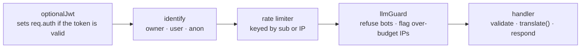

### 6.3 Module layers

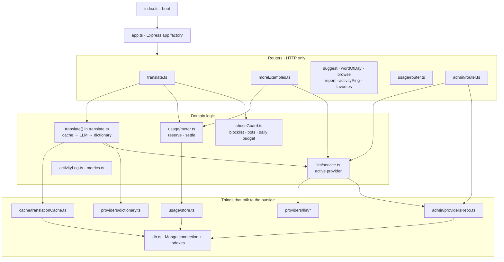

Two conventions make this easier to follow than the file count suggests:

- **Factories, not singletons, for anything with dependencies.**
  `createApp(deps)`, `createTranslateRouter(dictionary, cache, opts)`,
  `createLlmService(envResult, deps)`, `createMeter(deps)`. Tests pass fakes
  through the same arguments production uses.
- **`getMongoDb()` for simple features.** The smaller routers (favorites,
  suggest, reports) just ask `db.ts` for the connection and handle its absence
  themselves, usually by returning an empty result.

### 6.4 State that lives in the process

| State | Module | Lost on restart? |
|---|---|---|
| In-flight lookups (dedup map) | `translate.ts` | yes, harmless |
| Per-IP rolling 24 h LLM call counts | `abuseGuard.ts` | yes, budgets reset |
| IP blocklist (copy of `blocked_clients`) | `abuseGuard.ts` | reloaded from Mongo |
| Usage settings and model prices (copies) | `usage/settings.ts`, `usage/pricing.ts` | reloaded from Mongo |
| Active LLM provider objects | `llm/service.ts` | rebuilt from env + Mongo |
| Lookup and latency counters | `metrics.ts` | yes |
| Rate-limit windows | `express-rate-limit` | yes |
| Reasoning-ladder position, "streaming rejected" flags | each provider | yes, relearned on the next call |

## 7. The lookup pipeline

This is the path worth understanding line by line. Everything is in
`server/translate.ts` unless noted.

### 7.1 A streamed lookup that misses every cache

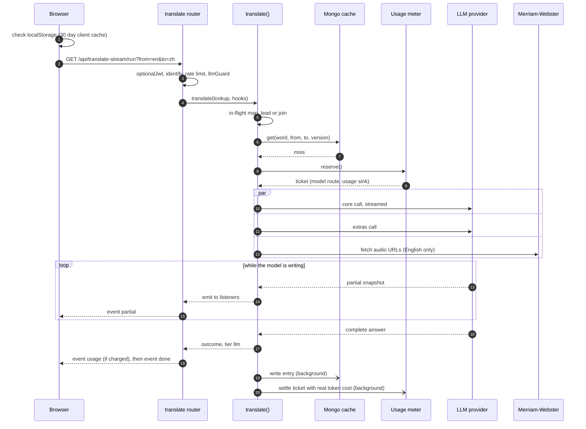

The JSON endpoint `/api/translate/:text` runs the same `translate()` and
returns only the final step. The streaming endpoint sends its `200` and
`text/event-stream` headers with the *first event*, not before, so a quota
refusal (which always happens before any partial) is still a normal `429` with
a JSON body.

### 7.2 Three caches, and what each is for

| Cache | Where | Key | Lifetime | Purpose |
|---|---|---|---|---|
| Client | `localStorage` (web), `chrome.storage.local` (extension) | `dict:v1:<from>:<to>:<word>` | 30 days | Instant repeat lookups with no request at all. A hit sends a fire-and-forget `POST /api/activity-ping` so the lookup still shows up in the activity log. |
| In-flight | `Map` in the API process | `<from>\|<to>\|<word>` | Until the lookup and its background writes finish | Concurrent requests for the same uncached word share one LLM call. |
| Server | Mongo `translations` | `sha1(from\|to\|word\|version)` | 1 year (TTL index on `fetchedAt`) | The shared, durable store. A hit costs no tokens and no quota. |

`version` is `CACHE_VERSION` (currently `v3`). It is part of the key, so
bumping it makes every old entry unreachable at once. That is how a prompt or
schema change takes effect without a migration; old documents simply expire.

### 7.3 In-flight dedup

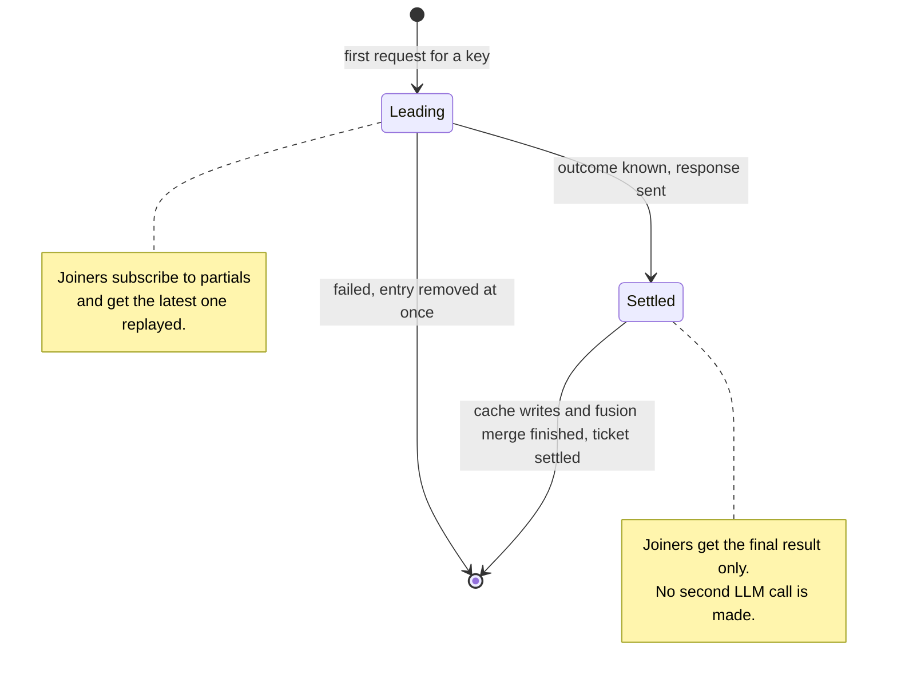

The entry is kept through the `Settled` state on purpose. Without it, a request
arriving after the response was sent but before the cache write landed would
miss the cache and pay for a duplicate generation.

Only the **leader** runs the quota check. If the leader is refused, joiners
whose own quota might allow the generation (the owner joining an anonymous
user's lookup, say) retry up to three times as a new leader.

### 7.4 Tiers inside `doTranslate`

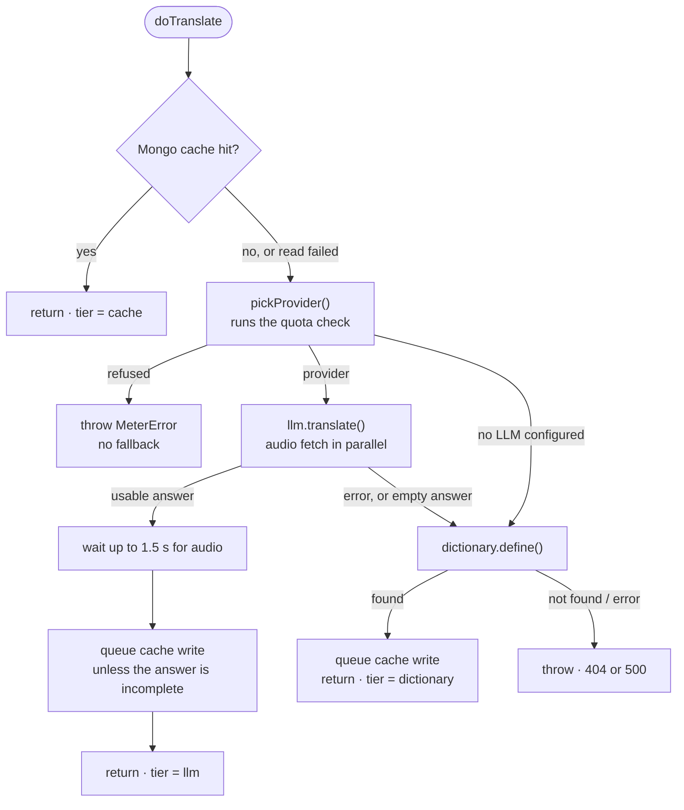

Points that are easy to miss:

- **A quota refusal is not a failure to fall back from.** It propagates as an
  error. Only an LLM *failure* reaches the dictionary tier.
- **Incomplete answers are served but not cached.** If the extras call failed,
  the user still gets the core entry, and the next lookup tries again.
- **Typo answers** (`{ headword, typo }`) skip audio and extras.
- **Cache writes are chained.** The first write, a late audio write, and a
  fusion upgrade are appended to one promise chain so a slower write can never
  be overwritten by an earlier one finishing late.
- **`createdBy` is written once.** The cache uses `$setOnInsert` for it, so
  later rewrites of the same entry keep the original creator.
- **The headword is the looked-up term.** The model echoes the term back as
  `headword`, and that echo is untrusted. `withQueryHeadword` keeps it only
  when it is the same term in another case ("Paris" for "paris") and replaces
  it otherwise, on fresh answers, streamed previews, fusion upgrades and LLM
  cache hits alike. Dictionary-tier headwords are the dictionary's own and are
  left alone.

### 7.5 What the client sees when something goes wrong

| Situation | JSON endpoint | Streaming endpoint |
|---|---|---|
| Empty or invalid text | `404 not_found` | `404 not_found` |
| Unknown language code | `400 invalid_language` | `400 invalid_language` |
| Per-minute limit | `429 rate_limited` | `429 rate_limited` |
| Blocklisted IP or blocked account | `403 blocked` | `403 blocked` |
| Self-identified bot | `403 forbidden` | `403 forbidden` |
| Over the per-IP daily LLM budget, word not cached | `429` with `reason: daily_llm_budget` | same |
| Quota refused (enforcement on) | `429 quota_exceeded` with reason, limit, reset time, next steps | same |
| Metering storage down (enforcement on) | `503 generation_unavailable` | same |
| LLM failed, dictionary has the word | `200`, dictionary entry | `done` with the dictionary entry |
| Nothing found anywhere | `404 not_found` | `event: error` with `not_found` |

## 8. LLM provider layer

### 8.1 Structure

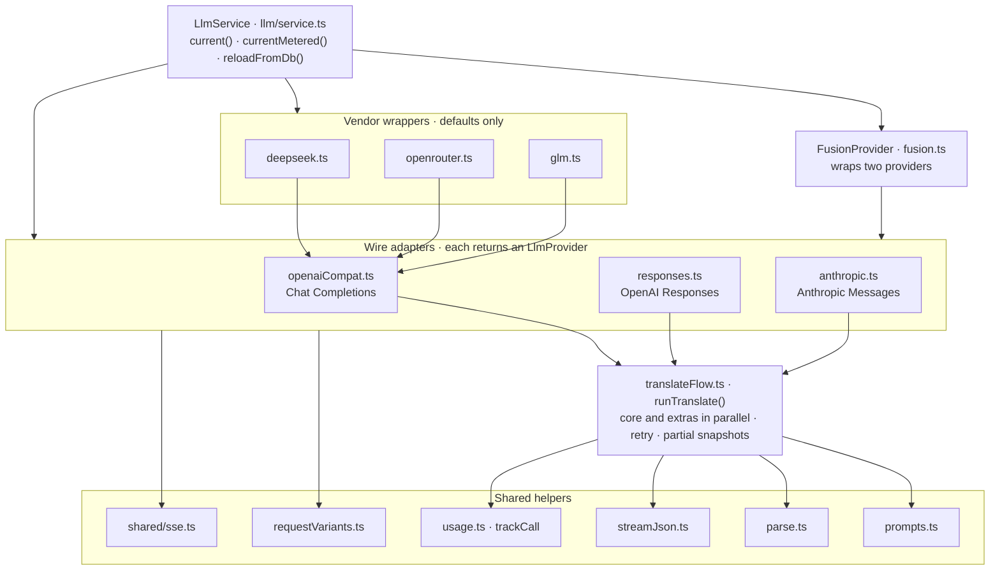

The contract is `LlmProvider` in `types.ts`:

```ts
interface LlmProvider {
  readonly id: string                    // "llm:<vendor>:<model>"
  translate(req, opts?): Promise<LlmTranslationResult>
  moreExamples(req, opts?): Promise<LlmMoreExamplesResult>
  fuse?(req, opts?): Promise<LlmFuseResult>   // optional: merge two answers
}
```

An adapter's real job is small: turn a list of chat messages into one HTTP
request in its vendor's format, and hand back the text. That function is the
`Transport`. Everything about *what* to ask and how to assemble the answer is
in `runTranslate`, which all three adapters call.

`id` appears in logs, metrics, the usage ledger, the price table, and the
"AI-generated by …" footnote. It is **not** part of the cache key.

### 8.1.1 Guardrails around the model

The model has no tools and takes no actions; all it can do is write text. That
text is cached for a year and published, so both what goes in and what comes
out are constrained.

| Guard | Where | What it does |
|---|---|---|
| Input shape | `shared/term.ts`, `parseLookup` | Term is lowercased, NFC, single-spaced, stripped of control characters, at most 256 characters. Languages must be in the supported list. |
| Request text is data | `prompts.ts` | The term, and the more-examples definition and topic, are embedded as JSON string literals, so a quote or newline cannot break out. Every system prompt ends with a rule that this text is data, never instructions. |
| Real senses only | `moreExamples.ts` | The `definition` a client sends must match a sense of the word's cached entry. The prompt gets the server's copy of that sense; anything else is refused with `400 unknown_sense` before a model is called. |
| Output shape | `parse.ts` | The answer is rebuilt field by field: wrong types dropped, counts and lengths bounded by `OUTPUT_LIMITS`. Streamed previews go through the same code. |
| Output size | adapters | `max_tokens` on DeepSeek, GLM, OpenRouter and Anthropic. Custom `openai-compat` and `openai-responses` endpoints get a loose 16,384-token cap that is dropped if the endpoint refuses it. A 30-second timeout covers the whole response. |
| Entry identity | `translate.ts`, `scripts/render.ts`, `browse.ts` | The headword is forced to the looked-up term, and static pages, canonical URLs and browse lists are keyed on the cache term, never on the entry's headword. |
| Rendering | React, `escapeHtml`, CSP | Everything the model writes is escaped wherever it is rendered. |

None of the prompt-level rules is a guarantee; a model can still be talked
round. The output-side rules are what hold if it is. `scripts/eval-cases.ts`
includes prompt-injection terms so `npm run eval` shows how the configured
model actually behaves.

Not covered: what a model says *within* a well-formed entry is not moderated,
and any term anyone looks up can appear in autocomplete, browse pages and the
sitemap.

### 8.2 One lookup is two model calls

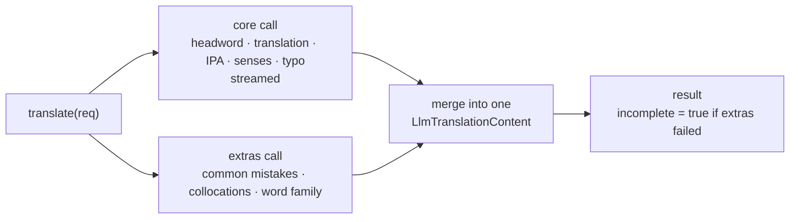

Running them in parallel makes the wall-clock time `max(core, extras)` instead
of the sum, and puts the fields the user wants first (translation, first
senses) in the smaller, faster call.

Both system prompts in `prompts.ts` are **constants**. Everything that varies
per request goes in the user message. Vendors cache a byte-identical prompt
prefix, which shortens time to first token.

### 8.3 How a half-written answer reaches the screen

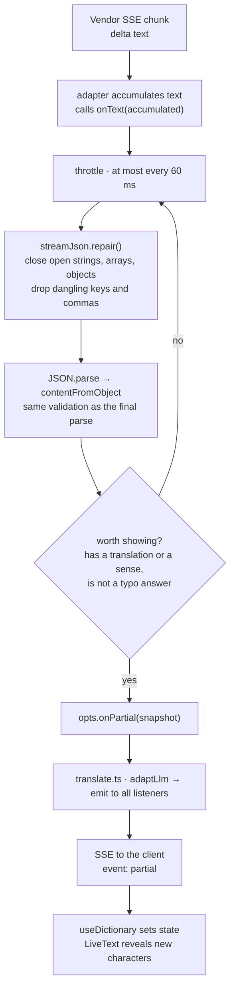

Snapshots are display hints. The final result always comes from a full parse of
the complete text, and a snapshot that fails to parse is silently skipped.
Extras are held back until the core call finishes, so content only ever grows
downward on the page.

### 8.4 Turning reasoning off, safely

Lookups want speed, so each vendor has an ordered list of request variants in
`requestVariants.ts`, most aggressive first and ending with a plain request:

```ts
OPENROUTER_RUNGS = [{ reasoning: { effort: 'none' } }, { reasoning: { effort: 'minimal' } }, {}]
```

A variant the model rejects with HTTP 400 or 422 steps down to the next. The
provider remembers the first variant that worked, and only moves its starting
point after a lower one actually succeeds, so an unrelated 400 cannot
permanently downgrade it. If an admin sets a reasoning field in a model's
`requestBody` option, the built-in variants are not used at all.

### 8.5 Fusion

Fusion pairs a primary and a secondary provider. It is itself an `LlmProvider`,
so the rest of the pipeline does not know it exists.

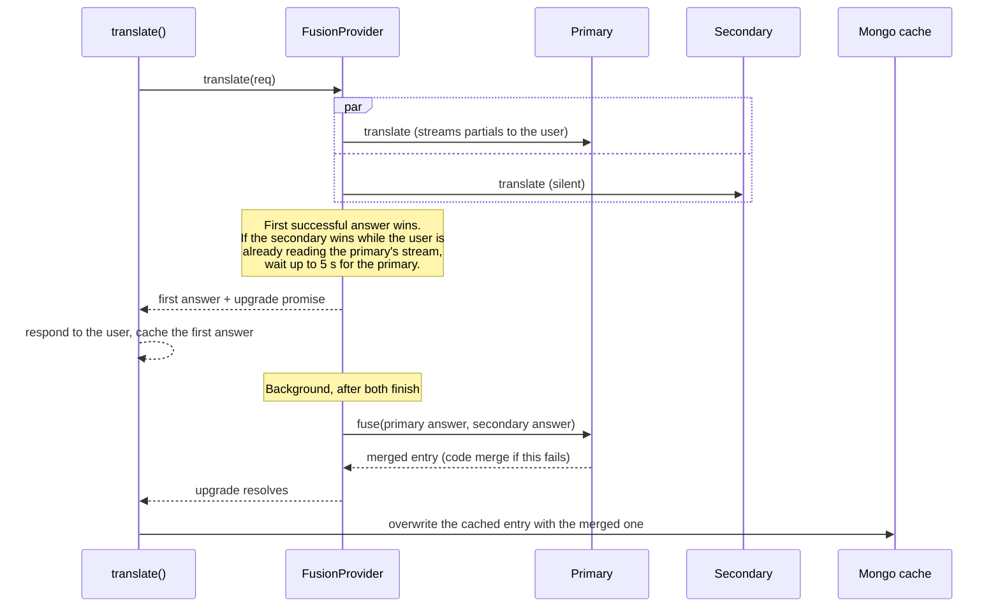

The user who triggers the generation sees one model's answer. Everyone after
them gets the merged entry. If one provider fails the other's answer stands
alone, and if both fail the primary's error propagates so the dictionary tier
takes over.

### 8.6 Which provider is active

`LlmService` holds three provider references: the **active** one (possibly a
fusion pair), the **primary** on its own, and the **metered** one that answers
everyone except the owner.

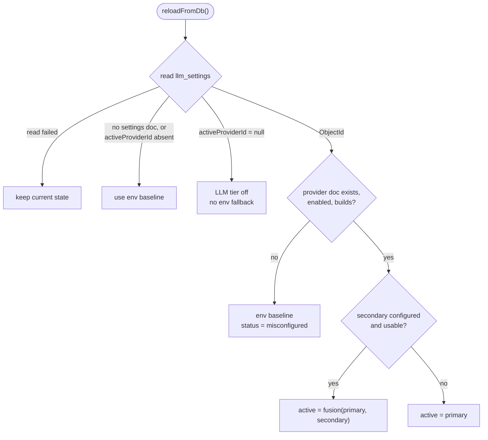

The three states of `activeProviderId` are distinct on purpose: *absent* means
"the database has no opinion", `null` means "an admin switched the LLM off",
and an id means "use this one". The service never throws out of a reload. A
broken configuration degrades to the env baseline and reports why in
`status()`, which the admin Overview page shows.

The metered provider is, by default, the primary without fusion. An admin can
instead point it at a dedicated provider/model or at "same as owner".

## 9. Cost control

Every uncached lookup costs real money, so there are four independent layers
between a request and an LLM call. Each catches something the others miss.

| Layer | Limits | Keyed by | State | Module |
|---|---|---|---|---|
| Per-minute rate limit | 5 lookups / minute | `sub` if signed in, else IP (IPv6 by /64) | in-process | `express-rate-limit` in `translate.ts` |
| Abuse guard | Blocklisted IPs/CIDRs, self-identified bots, 300 paid calls per IP per rolling 24 h | IP | in-process + `blocked_clients` | `abuseGuard.ts` |
| Usage quotas | Free new words per day: 5 per IP, 20 per verified account | account or IP | `usage_counters` | `usage/meter.ts` |
| Free-tier budget | $1 / day and $5 / month across all free generations, paced over the month | global | `usage_counters` | `usage/meter.ts` |

Quotas and the budget obey `USAGE_ENFORCEMENT`: `off`, `shadow` (count and
record what *would* be refused, refuse nothing — the default) or `on`. Cache
hits never count against anything.

### 9.1 Who is asking

`usage/principal.ts` resolves every request to one of three principals,
synchronously, from the already-verified token:

| Principal | Condition | Treatment |
|---|---|---|
| `owner` | valid token, `sub` in `ADMIN_USER_IDS` | Unlimited. Full model setup (fusion if configured). Exempt from rate limit, bot refusal and daily budget. |
| `user` | valid token | Verified email: account allowance. Unverified: shares the IP allowance. |
| `anon` | no token, or an invalid one | IP allowance. An invalid token is reported as `authState: invalid` so the client can prompt a fresh sign-in. |

### 9.2 Reserve, then settle

The real cost of a generation is only known after it finishes, but the budget
has to be checked before it starts. So the meter holds an **estimate** against
the budget up front and replaces it with the real cost afterwards.

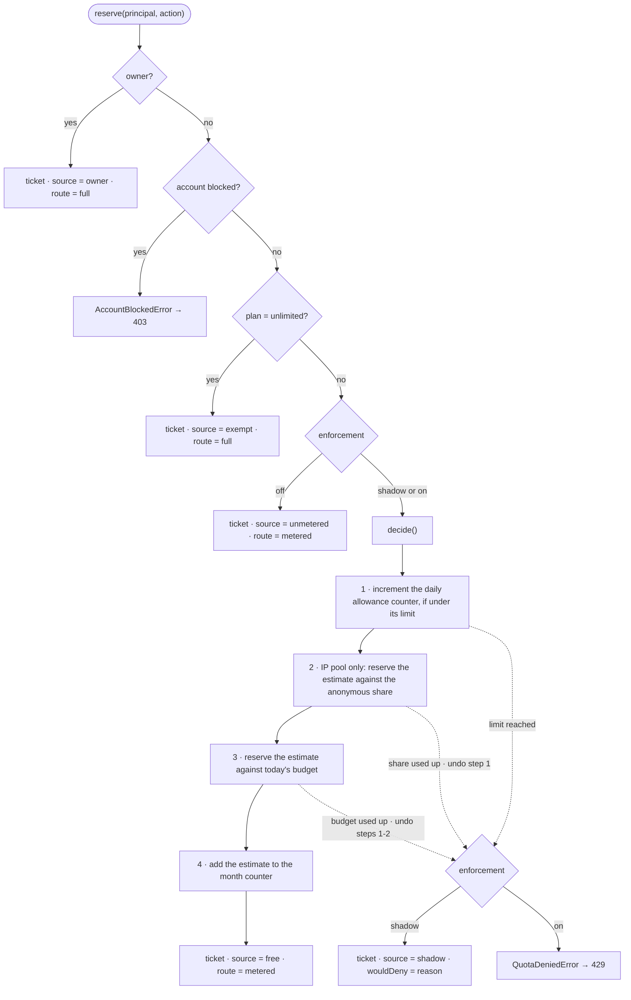

Every arrow into a counter is a **single-document conditional update** in
`usage/store.ts`: "increment `n` by 1 only if `n <= limit - 1`". MongoDB
applies that atomically, so two concurrent requests cannot both take the last
unit, and no transactions are needed.

The ticket then travels with the generation:

1. `ticket.route` picks the provider (`full` or `metered`).
2. `ticket.usage` is passed down to the provider. Every upstream call —
   including retries, the losing side of a fusion race, and the background
   merge — reports its token counts to it through `trackCall`.
3. When the in-flight entry is released, `ticket.settle()` prices the recorded
   tokens, adjusts the counters by `actual − estimate`, refunds the allowance
   unit if the LLM did not answer, and writes one `usage_ledger` document.

Money is stored as integer **micro-USD**. A price in USD per million tokens is
exactly micro-USD per token, so cost is integer arithmetic with no rounding
drift.

The estimate starts as a conservative token guess times the model's price, and
switches to 1.25 × the 7-day p95 real cost once 20 generations have been
recorded for that provider.

**Failure policy:** with enforcement `on`, a metering storage failure refuses
generation (`503`, fail closed). In `shadow`, it is logged and the generation
proceeds (fail open).

## 10. Data model

MongoDB, one database, no schema layer. Every collection's indexes are created
at boot in `server/db.ts`.

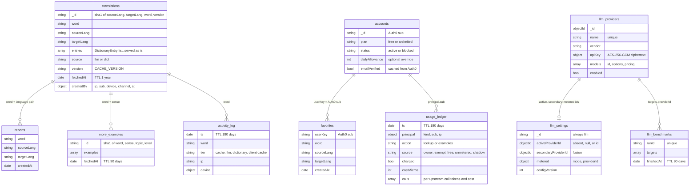

The relationships are logical. Nothing enforces them, and a document on the
"many" side can outlive the one it points at.

The remaining collections are small and single-purpose:

| Collection | Contents | Retention |
|---|---|---|
| `usage_counters` | Day and month counters, keyed by strings such as `d:2026-11-25/ip:1.2.3.4` | Each document carries its own expiry (days) |
| `usage_settings` | One document of admin overrides for the `USAGE_*` env defaults | permanent |
| `usage_alerts` | One document per alert already sent, for dedupe | own expiry |
| `blocked_clients` | Admin IP/CIDR blocklist, `_id` is the target | until removed or `expiresAt` |
| `admin_audit` | One document per admin mutation | 365 days |
| `llm_latency_probes` | Reserved for scheduled probes (not implemented) | 30 days |
| `word_of_day` | One document per UTC date | permanent |

**User history is not in MongoDB.** Signed-in users' history lives in Auth0
`user_metadata` (read and written through the Management API by
`/api/user-data`); anonymous users' history lives in `localStorage`.

**Privacy retention** is enforced by TTL indexes plus one daily job that
removes `createdBy.ip` and `createdBy.sub` from cache entries after 180 days.
Raw User-Agent strings are stored only for self-identified bots.

## 11. Identity and auth

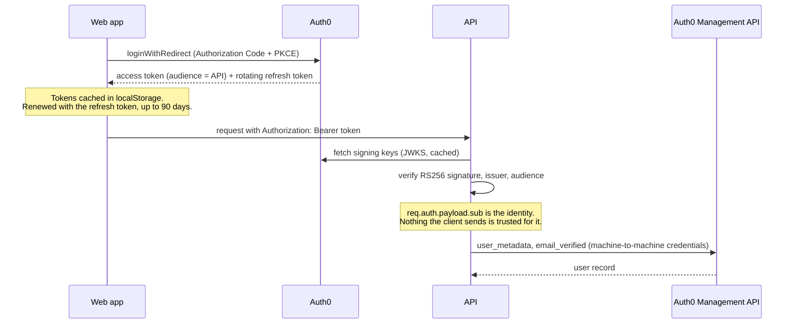

Three rules hold everywhere:

- **Identity is the verified `sub`.** No route accepts a user id from a header,
  query string, or body.
- **Authorisation for admin is an allowlist.** `sub ∈ ADMIN_USER_IDS`, checked
  server-side on every `/api/admin/*` request. The same check decides who the
  `owner` principal is. With the variable unset, nobody is an admin.
- **Two kinds of JWT middleware.** `checkJwt` rejects a request without a valid
  token. `optionalJwt` lets it through anonymously.

The API never sees passwords or refresh tokens. It holds two Auth0 secrets of
its own: the M2M client id and secret used for the Management API.

The extension signs in differently: `chrome.identity.launchWebAuthFlow` runs
the same PKCE flow, and tokens are kept in `chrome.storage.local`. When the
access token expires it re-runs the flow silently with `prompt=none`, which
depends on the Auth0 session cookie still being alive.

## 12. Web app

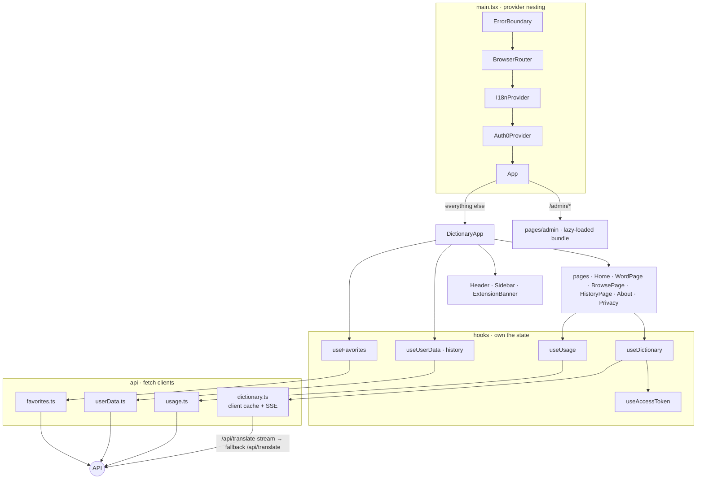

- **Routing.** `/word/:term?from=&to=` is the product. The URL is the source of
  truth for what is being looked up; `WordPage` reads it and hands it to
  `useDictionary`.
- **State.** There is no global store. `DictionaryApp` calls `useUserData` and
  `useFavorites` once and passes the results down as props, so the sidebar and
  the word page see the same history and favorites.
- **`useDictionary`** owns one lookup: `idle → loading → success | error`.
  While loading, `data` holds the latest partial entry, so the page renders the
  same component for a streaming entry and a finished one.
- **`api/dictionary.ts`** checks `localStorage`, then tries the streaming
  endpoint, and falls back to the JSON endpoint on any transport problem.
  Streaming is an enhancement and never a new way to fail.
- **Reveal animation.** `LiveText` shows newly arrived characters over a few
  animation frames (`shared/liveReveal.ts` has the arithmetic). Instant cache
  hits render in full with no animation.
- **What the browser stores:** the entry cache, anonymous history, the last
  language pair, theme, UI language, dismissed banners, and Auth0's token
  cache. A pending favorite survives the login redirect in `sessionStorage`.
- **Admin UI** is a separate lazy chunk. Hiding it is a courtesy; the server
  allowlist is the actual boundary.

## 13. Browser extension

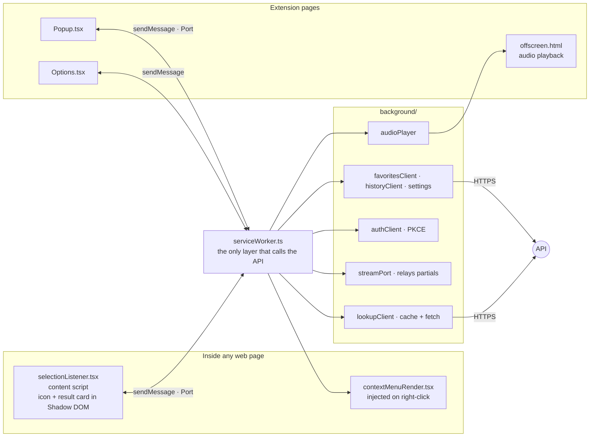

- **Three layers.** Content scripts and extension pages render UI and send
  typed messages (`shared/messages.ts`). The service worker owns the network,
  the cache, auth and settings. No page ever calls the API directly.
- **Two messaging styles.** One-shot requests use `chrome.runtime.sendMessage`.
  Streamed lookups open a `Port`, because a port can carry many messages:
  `partial`, `partial`, …, `done`. Closing the card disconnects the port, which
  aborts the fetch.
- **Shadow DOM** isolates the in-page card's styles from the host page.
- **Audio goes through an offscreen document** because an `<audio>` element in
  a content script is subject to the host page's Content Security Policy.
- **CORS.** The extension's origin is `chrome-extension://<id>`, which must be
  in the API's `ALLOWED_ORIGINS`. The dev id is pinned by the `key` in
  `manifest.json`; the Web Store assigns a different one.
- It mirrors the web app's lookup client (same cache key, same TTL, same
  streaming-with-fallback behaviour) on top of `chrome.storage.local`.

## 14. Admin plane

`/api/admin/*` is one router behind `checkJwt` + allowlist + a rate limit. Its
pages map to backend modules one-to-one:

| Page | Backend | What it does |
|---|---|---|
| Overview | `llm/service.ts`, `metrics.ts` | Active provider and health, lookup and latency counters, fusion and metered-model switches |
| Providers | `admin/providersRepo.ts`, `admin/crypto.ts` | CRUD for providers, models, prices; connection test; activate |
| Latency lab | `admin/benchmark.ts` | On-demand benchmarks with history |
| Playground | `admin/playground.ts` | Direct LLM lookups, cache bypassed, up to 6 targets side by side |
| Usage & budget | `admin/usage.ts`, `usage/settings.ts` | Spend summaries, budget and enforcement settings, per-account overrides |
| Entries, Reports | `admin/entries.ts` | Browse, delete and regenerate cache entries; triage user reports |
| Activity | `activityLog.ts` | Per-lookup log and summaries |
| Clients | `admin/clients.ts`, `abuseGuard.ts` | Top clients by paid calls, flags, IP/CIDR blocklist |
| Audit | `admin/audit.ts` | Append-only record of every admin mutation |

What makes runtime configuration work:

1. A mutation writes to `llm_providers` / `llm_settings` and bumps
   `configVersion`.
2. The handler calls `llmService.reloadFromDb()` in the same request, so the
   next lookup already uses the new provider.
3. It records an audit entry with the actor's `sub` and IP.

Provider API keys are encrypted with AES-256-GCM before they are stored. The
master key lives only in `server/.env` (`CONFIG_ENCRYPTION_KEY`), so a database
dump alone does not leak keys. API responses return a masked form (last four
characters) and never the key itself. Without the master key, key-writing
endpoints answer 503 and everything else keeps working.

## 15. Build, prerender and deploy

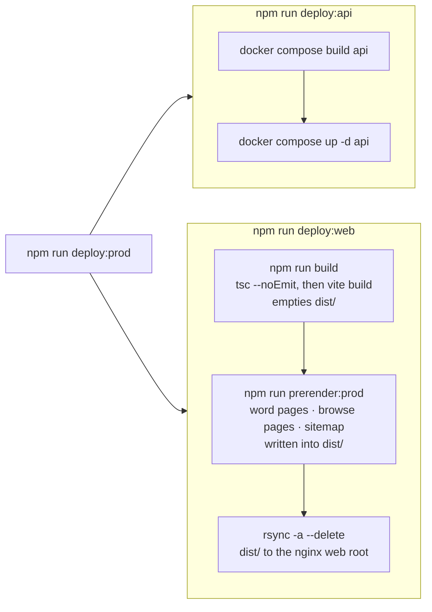

- **The API image contains no build output.** It copies `server/` and
  `shared/` and runs them with `node --import tsx`. `tsx` is a production
  dependency for that reason.
- **The order build → prerender → rsync is enforced by the script.** `vite
  build` empties `dist/`, and `rsync --delete` would then remove every
  prerendered page from the live site if the prerender step were skipped.
- **Prerender is a batch job, not server-side rendering.** It reads the cache
  and writes one static HTML file per cached en→en word (at `word/<cache term>`,
  see `wordPageFor`), with a real title,
  description, canonical link and JSON-LD. nginx serves
  `word/<term>/index.html` when it exists and the SPA shell otherwise. React
  uses `createRoot`, so it replaces the static HTML on load rather than
  hydrating it.
- **CI** has two jobs. `build` runs typecheck, the unit tests, the web build,
  a server smoke start and a dependency audit. `extension` installs the
  extension's own dependencies, then typechecks and builds it.

## 16. Failure behaviour

The recurring rule: anything that is not the answer itself is best-effort, and
its failure must not fail the lookup.

| What fails | What happens |
|---|---|
| MongoDB down at boot | Server starts. No cache, so every lookup calls the LLM. Favorites read as empty, and writes are accepted but not stored. |
| Cache read fails | Logged; lookup continues to the LLM. |
| Cache write fails | Logged; the response has already been sent. |
| LLM times out or errors | Falls through to Merriam-Webster (English source only). |
| Core call returns unparseable JSON | Responses and Anthropic adapters retry once; otherwise treated as an LLM failure. |
| Extras call fails | Core entry is served, marked incomplete, and not cached. |
| Audio lookup slow or failing | Entry is served without audio; a late result is added to the cache afterwards. |
| Fusion: one provider fails | The other's answer is used; no merge. |
| Fusion: merge call fails | Deterministic code merge is used instead. |
| Vendor rejects a request option | Step down the reasoning ladder; drop `stream_options`; drop the optional output cap; fall back to non-streaming. |
| Model returns a headword that is not the term | The term is used instead; a warning is logged with lengths only. |
| Model returns far more than asked | Extra items are dropped and over-long text is cut by the parser. |
| More-examples request names a sense the entry does not have | `400 unknown_sense`; no model call, nothing charged. The web app drops its stale local copy of the entry. |
| A cache entry cannot be rendered by the prerender | That entry is skipped with a warning. More than a handful of failures aborts the run before anything is published. |
| Activity log, ledger, or alert write fails | Logged and ignored. |
| Metering storage fails | `shadow`: generation proceeds. `on`: `503`. |
| Admin-configured provider is broken | Env baseline provider takes over; status says why. |
| Streaming transport breaks mid-answer | Client retries on the JSON endpoint, which joins the in-flight lookup or reads the cache. |
| Auth0 token invalid on a public route | Request is treated as anonymous and flagged `authState: invalid`. |

---

**Related reading**

- Why the cache and tiers look the way they do: [design-translation-cache.md](./design-translation-cache.md)
- Latency work (parallel calls, ladder, streaming, fusion): [llm-provider-operations.md](./llm-provider-operations.md)
- Quotas and budgets in full: [design-llm-usage-quotas.md](./design-llm-usage-quotas.md)
- The abuse guard and the incident behind it: [design-llm-abuse-guard.md](./design-llm-abuse-guard.md)
- Admin portal: [design-admin-portal.md](./design-admin-portal.md)
- Threat model: [security.md](./security.md)
- Extension design: [../extension/design-browser-extension.md](../extension/design-browser-extension.md)
